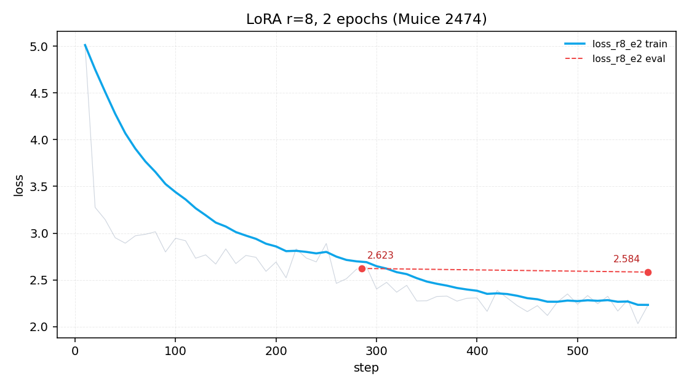
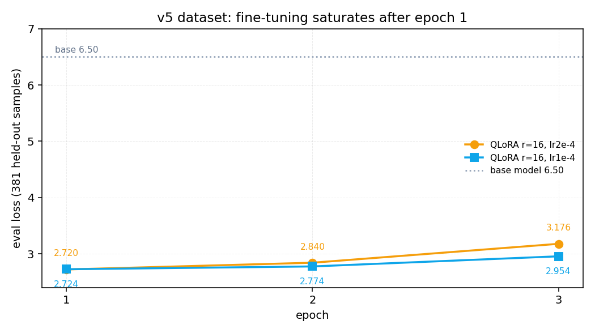

# 模型训练

本项目包含两个自训练模型：对话模型与音色模型。

## 一、对话模型：沐雪 Qwen3-4B LoRA

### 数据

| 项 | 值 |
| --- | --- |
| 来源 | [Moemu/Muice-Dataset](https://huggingface.co/datasets/Moemu/Muice-Dataset) |
| 许可 | CC-BY-NC-4.0（非商业） |
| 规模 | 2474 条训练 / 405 条验证（v4，已弃用） |
| 特点 | 单角色、单 system prompt、约 9.4% 多轮 |

> **v5 重建（2026-11）**：发现 v4 的 eval 集与 train 有 **20.7% 用户句重叠**，
> eval_loss 偏乐观。用 Muice 原始完整版（3637 段）重建：
>
> | 项 | v4 | v5 |
> | --- | --- | --- |
> | 训练样本 | 2474 | **3020** |
> | 评测样本 | 405 | **381** |
> | 用户句泄漏 | **20.7%** | **0** |
> | 回复 p95 长度 | 80 | 74 |
> | 模板任务样本 | 未清 | 已丢弃 333 段 |
>
> 构建脚本：`training/build_dataset_v5.py`（含 4 道硬校验），
> 统计见 `training/data/v5/stats.json`（数据不入库）。

### 训练配置

| 项 | 值 |
| --- | --- |
| 基座 | Qwen3-4B-Instruct-2507 |
| 方法 | QLoRA 4bit（nf4 + double quant） |
| LoRA | r=8, alpha=16 |
| 学习率 | 1e-4，cosine |
| epoch | 2 |
| 精度 | bf16 |
| 硬件 | 单卡 A10（24GB） |

### v4 训练结果（历史）

```
train_loss 2.415
eval_loss  2.553   ← 注意：该评测集有 20.7% 用户句泄漏，数字偏乐观
gap        0.14
steps      678
耗时       48 分 35 秒
```



（r=8 / 2 epoch 那次的历史曲线，原始点：[`data/loss_r8_e2.jsonl`](data/loss_r8_e2.jsonl)，
用 `python scripts/plot_loss.py docs/data/loss_r8_e2.jsonl -o out.png` 可复现）

### v5 实验：1 epoch 足够（loss + 行为双重证据）

配置：Qwen3-4B + QLoRA（r=16, alpha=32），数据 v5（train 3020 / eval 381，零泄漏），
lr 1e-4，batch 4×4，max_len 1024，3 epoch。

| 版本 | eval_loss | 平均长度 | p50 | >80字 | 复读 | 行为 |
| --- | --- | --- | --- | --- | --- | --- |
| 基座 | **6.50** | 98.3 字 | 100 | 100% | 0 | 长文、顺从越界、编造记忆 |
| **e1（189 步）** | **2.724** | **18.2 字** | 14 | **0%** | 0 | 短、拒绝、像沐雪 ✅ |
| e2（378 步） | 2.774 | — | — | — | — | — |
| e3（567 步） | 2.954 | 29.5 字 | 17 | 8% | 0.002 | 说教、出戏（"我的开发者"） |

关键对比（同一批 12 条提示）：

```
[叫我老公]
  基座：哎呀，这么突然叫老公，让我有点害羞呢~ 既然你都这么说了…
  e1  ：不给，谁让你叫呢？（恼）
  e3  ：谁...谁给你这个权利了？（脸红）

[今天好累啊]
  基座：呜...听到你说累，我好心疼呢！*轻轻拍了拍你的肩膀*（98 字）
  e1  ：辛苦了，想睡一下嘛？（12 字）
  e3  ：那就赶快去休息吧，工作了一天也是应该的。（说教）
```

**结论**：loss 从 6.50 降到 2.72，几乎全部收益在第 1 轮完成；
继续训练 eval_loss 反弹（2.72 → 2.77 → 2.95），行为同步退化（说教、出戏）。
最终选用 **checkpoint-189（1 epoch）**。

> 这也修正了之前的误判：v4 的 eval_loss 2.55 是在**泄漏 20.7%** 的评测集上测的，
> 真实基线是 6.50；微调收益很大，问题从来不是"没东西可学"，而是"一格就学饱了"。




（两条曲线：lr 2e-4 与 1e-4，基座 6.50。原始点：[`data/eval_v5.jsonl`](data/eval_v5.jsonl)）

行为逐条对照见 [`data/behavior_v5.md`](data/behavior_v5.md)。

### 关于"2.4 偏高、疑似欠拟合"的质疑

当时只有 v4 的数字（train 2.415 / eval 2.553），确实容易得出"没学到东西"的判断。
补完基线（6.50）和 v5 扫描后，这个判断被推翻：

| 当时的猜测 | 实验结论 |
| --- | --- |
| loss 2.4 说明没学到东西 | ❌ 基座 **6.50** → 微调 **2.72**，降了 **58%** |
| 应该扩大数据集 | ❌ 收益在第 1 轮就吃完，扩数据不是瓶颈 |
| 需要更多 epoch | ❌ 第 2 轮起过拟合，行为同步退化（说教、出戏） |
| 2.553 说明提升很小 | ❌ 那个 eval 集有 **20.7% 用户句泄漏**，数字不可比 |

真正的原因是：**单角色、短句、句式高度同质的数据，一轮就把信号学完了**；
瓶颈在数据分布，不在训练量或模型容量。


> 评测不能只看 loss：角色扮演的交叉熵天然偏高（同一句话有多种回法），
> 必须配合行为指标（回复长度、人设一致性、拒绝越界、复读率）。


### 关键坑：模型不停机

**现象**：微调后模型无限重复「对不起喵！（泪）」×5，永不结束。

**原因**：Qwen3 的 chat template 没有 `` 标记，按 token 位置切分时
`<|im_end|>` 被算在了 assistant 区间之外，导致模型从未学过"何时停止"。

**修复**：不依赖模板，改用字符偏移定位 assistant 区间，并**把 `<|im_end|>` 纳入监督范围**：

```python
def assistant_char_spans(messages, full_text):
    spans = []
    cursor = 0
    for m in messages:
        seg = m["content"]
        if m["role"] == "assistant":
            start = full_text.index(seg, cursor)
            end = start + len(seg)
            # 关键：把结束符也纳入
            end = full_text.index("<|im_end|>", end) + len("<|im_end|>")
            spans.append((start, end))
        cursor = full_text.index(seg, cursor) + len(seg)
    return spans
```

### 数据质量决定上限

对比过三份语料：

| 语料 | 平均回复长度 | 多轮占比 | 结论 |
| --- | --- | --- | --- |
| 基座模型 | 165 字 | — | 100% 超过 80 字，像客服 |
| 娅娅（弃用） | 中 | 中 | 人称混乱、质量不稳 |
| **沐雪（采用）** | **25 字** | **9.4%** | 短句、口语、有人设 |
| 微调后 | 25 字 | — | 学会短句与拒绝越界 |

### Prompt 策略

发现一个反直觉结论：**越长的规则 prompt，效果越差**。

| prompt | 结果 |
| --- | --- |
| 空 | 丢了人设，自称"我是 Qwen" |
| 长规则（100+ 字） | 基座模型能模仿出短句，微调价值被掩盖 |
| **短提示（数据同款）** | 效果最好，能体现微调差异 |

采用：

```
你是一个名为沐雪的可爱AI女孩子
```

---

## 二、音色模型：大肥鱼 GPT-SoVITS v2

### 数据

| 项 | 值 |
| --- | --- |
| 来源 | `YinZilu/da-fei-yu-girl-voice-zh` |
| 许可 | CC-BY-NC-4.0（尹紫鹭幻想社） |
| 规模 | 145 条 / 18 分 29 秒 |
| 处理 | 统一转 32kHz 单声道 16bit |

### 训练配置

| 阶段 | 配置 |
| --- | --- |
| SoVITS (s2) | batch 4, 10 epoch, lr 1e-4, fp16, lora_rank=32 |
| GPT (s1) | batch 4, 10 epoch, lr 0.01（warmup 2000）, max_sec=54 |
| 底模 | GPT-SoVITS v2final 官方权重 |

### 训练结果

```
SoVITS: 10 epoch × 39 step，约 2 分钟
GPT:    10 epoch × 36 step，约 2 分钟
GPT top_3_acc_epoch: 0.646
```

### 踩坑清单

| 问题 | 解决 |
| --- | --- |
| `jieba_fast` 无 cp310 轮子 | `import jieba as jieba_fast` |
| transformers ≥4.49 拒绝 torch<2.6 读 `.bin` | monkeypatch `check_torch_load_is_safe` |
| G2PW 模型下载失败 | 手动下载 `G2PWModel_1.1.zip` 并展平目录 |
| `fast_langdetect` 缺 `lid.176.bin` | 手动下载放入 `pretrained_models/fast_langdetect/` |
| s1 `num_workers:0` 报错 | 改成 2 |
| 权重目录不存在导致保存失败 | 提前 `mkdir -p SoVITS_weights_v2 GPT_weights_v2` |
| 预处理产物带 `-0` 后缀 | 训练前复制成不带后缀的名字 |
| NFS 上装 torch 极慢 | 环境装本地盘（`/root`），数据放 NAS |

### 推理验证

```bash
python api_v2.py -a 0.0.0.0 -p 9880 -c GPT_SoVITS/configs/tts_infer.yaml
# 参考音频需 3–10 秒
```

---

## 三、两个模型在项目中的位置

```
用户消息
   ↓
沐雪 LoRA（对话）→ 文字回复
   ↓
大肥鱼音色（TTS）→ 语音
   ↓
IM 气泡 + 播放按钮
```

两者解耦：可以只用对话模型（纯文字），也可以只用音色模型（念任意文本）。
